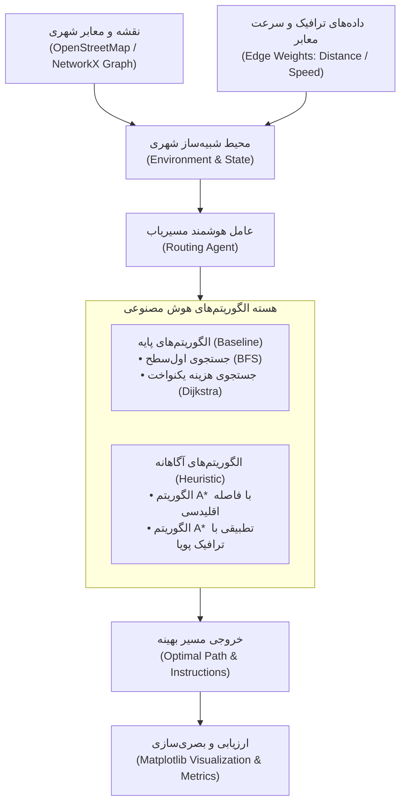

# نقشه راه جامع پروژه مسیریابی هوشمند شهری (Urban Route Finding AI)
### آزمایشگاه هوش مصنوعی — برنامه گام‌به‌گام ۱۰ مرحله‌ای از ایده تا ارائه نهایی

---

## 🧭 ۱. نمای کلی پروژه (Project Overview)

این سند، مرجع کامل و یکپارچه پروژه **مسیریابی هوشمند شهری** است. هر فردی از اعضای گروه، استاد محترم، یا ارزیاب‌های آینده با مطالعه این سند دقیقاً متوجه می‌شوند که:
- پروژه چیست و چه هدفی دارد؟
- در هر جلسه از ترم چه کارهایی باید انجام شود؟
- مسئولیت هر کدام از ۴ نقش گروه چیست؟
- الگوریتم‌ها و ساختار داده‌ها در هر گام چگونه توسعه پیدا می‌کنند؟

### نمایی از معماری سیستم مسیریابی شهری

---

## 🛠️ ۲. جعبه‌ابزار و فناوری‌های پروژه (Tech Stack)

* **زبان برنامه‌نویسی:** Python 3.10+
* **محیط توسعه:** VS Code + Jupyter Extension
* **مدیریت گراف و شبکه معابر:** `networkx`, `osmnx` (در صورت نیاز به استخراج نقشه واقعی از OpenStreetMap)
* **محاسبات عددی و داده‌ها:** `numpy`, `pandas`
* **رسم نمودار و بصری‌سازی مسیر:** `matplotlib`, `seaborn`, `folium` (جهت رسم نقشه تعاملی HTML در گام‌های پیشرفته)
* **کنترل نسخه و تحویل:** Git & GitHub

---

## 📅 ۳. تقویم زمانی ۱۰ گام پروژه

| گام | موعد تحویل | عنوان گام | تمرکز فنی اصلی |
| :---: | :---: | :--- | :--- |
| **گام ۱** | قبل جلسه ۳ | **تعریف مسئله، PEAS و آماده‌سازی محیط** | تعریف PEAS، ویژگی‌های محیط، سلامت‌سنجی پایتون، تحلیل ریسک‌ها |
| **گام ۲** | قبل جلسه ۴ | **ساخت یا جمع‌آوری داده / محیط گراف شهری** | ایجاد گراف خیابان‌ها، گره‌ها، یال‌ها و اوزان مسافت و ترافیک |
| **گام ۳** | قبل جلسه ۵ | **مرور و تحلیل اکتشافی داده‌ها (EDA)** | تحلیل آماری گراف، هیستوگرام طول خیابان‌ها، تحلیل اتصال‌پذیری |
| — | جلسه ۶ | *امتحان میان‌ترم دانشگاه* | *بدون تحویل پروژه* |
| **گام ۴** | قبل جلسه ۷ | **پیاده‌سازی مدل پایه (Baseline)** | پیاده‌سازی جستجوی ناآگاهانه (BFS و Dijkstra بدون هیوریستیک) |
| **گام ۵** | قبل جلسه ۸ | **پیاده‌سازی الگوریتم اصلی آگاهانه** | پیاده‌سازی $A^*$ با هیوریستیک مسافت مستقیم و تقریب زمان |
| **گام ۶** | قبل جلسه ۹ | **ارزیابی با معیارهای مناسب** | اجرای آزمایش‌های چندباره، محاسبه زمان سفر، تعداد گره‌ها و طول مسیر |
| **گام ۷** | قبل جلسه ۱۰ | **مقایسه علمی حداقل دو روش** | مقایسه تجربی BFS vs Dijkstra vs $A^*$ در قالب جداول و نمودارهای میله‌ای |
| **گام ۸** | قبل جلسه ۱۱ | **تحلیل خطا، سوگیری و جنبه‌های اخلاقی** | تحلیل مسیرهای بن‌بست، خطای GPS، ترافیک‌زدایی ناعادلانه از مناطق مسکونی |
| **گام ۹** | قبل جلسه ۱۱ | **مستندسازی نهایی و تمیزکاری مخزن** | آماده‌سازی داکیومنت جامع، مستندات کدها و ریپازیتوری نهایی |
| **گام ۱۰** | جلسه ۱۱ تا ۱۴ | **ارائه و دفاع حضوری ۱ ساعته** | ارائه تیمی (هر یک از ۴ عضو به مدت ۱۵ دقیقه از تسک خود دفاع می‌کند) |

---

## 📌 ۴. شرح تفصیلی گام‌به‌گام (Step-by-Step Breakdown)

---

### 🔹 گام ۱ (جلسه ۳): تعریف مسئله، PEAS و آماده‌سازی محیط
* **هدف:** مشخص کردن دقیق دامنه پروژه، تعریف عامل، تنظیم محیط‌های توسعه و گیت‌هاب اعضا.
* **خروجی‌ها:**
  1. فایل `README.md` شامل شرح مسئله، جدول PEAS، و جدول ۶ ویژگی محیط.
  2. نوت‌بوک `check_env.ipynb` با خروجی‌های چاپ نسخه و نمودار تست.
  3. فایل `notes/risks.md` با حداقل ۳ ریسک فنی و محیطی.
  4. نوت‌بوک بهبود کلاسی `lab1_improved.ipynb`.
* **وظایف نقشی:**
  * *ایده‌پردازی (ایلیا):* تدوین متن PEAS و فلسفه ویژگی‌های محیط.
  * *کدنویسی (سپهر):* ساخت اسکریپت تست و نوت‌بوک بهبودیافته کلاسی.
  * *داده و ارزیابی (قائدیان):* تدوین سنجه‌های عملکرد و ریسک‌های شهری.
  * *مستندسازی (سینا):* ویرایش و زیباسازی README و فایل ریسک‌ها.
  * *نماینده (ایلیا):* ارسال گزارش تجمیعی لینک مخازن به استاد.

---

### 🔹 گام ۲ (جلسه ۴): ساخت یا جمع‌آوری داده / محیط شهری
* **هدف:** ساخت یک شبکه معابر معتبر با کتابخانه `networkx` که معرف خیابان‌های یک شهر باشد.
* **مشخصات فنی:**
  * گره‌ها (Nodes): تقاطع‌ها و میدان‌ها با مختصات $(x, y)$.
  * یال‌ها (Edges): معابر، خیابان‌ها و بزرگراه‌ها با ویژگی‌های: طول معبر (`length`)، سرعت مجاز (`max_speed`)، جهت‌دار بودن (`oneway`) و ضریب ترافیک لحظه‌ای (`traffic_factor`).
* **وظایف نقشی:**
  * *طراحی:* انتخاب ساختار شبکه (چهارراهی Grid یا توپولوژی یک شهر واقعی مثل بخشی از تهران یا اصفهان).
  * *کدنویسی:* کدنویسی ساخت گراف در NetworkX و تابع ذخیره/بازیابی (`graph.gml` یا JSON).
  * *داده:* اعتبارسنجی مقادیر سرعت و طول و تفکیک داده‌های تست مسیرها.
  * *مستندات:* توضیح ساختار گراف و منبع داده در README.

---

### 🔹 گام ۳ (جلسه ۵): مرور داده‌ها (EDA - Exploratory Data Analysis)
* **هدف:** شناخت عمیق ساختار شبکه معابر با استفاده از ابزارهای آماری و نموداری.
* **فعالیت‌های کلیدی:**
  * تحلیل درجه تقاطع‌ها (چند تا ۴‌راه، چند تا ۳‌راه، بن‌بست‌ها).
  * رسم هیستوگرام توزیع طول خیابان‌ها و میانگین سرعت معابر.
  * رسم گراف با `matplotlib` و نمایش معابر بر اساس حجم ترافیک فرضی (طیف رنگی سبز تا قرمز).
* **وظایف نقشی:**
  * *طراحی:* تعیین پرسش‌های کلیدی (کدام تقاطع‌ها گلوگاه هستند؟).
  * *کدنویسی:* توابع رسم نمودارها و استخراج ماتریس‌های مجاورت.
  * *داده:* محاسبه میانگین، واریانس، ماکزیمم طول معابر با Pandas.
  * *مستندات:* تفسیر نتایج آماری در نوت‌بوک و README.

---

### 🔹 گام ۴ (جلسه ۷): پیاده‌سازی مدل پایه (Baseline)
* **هدف:** ساخت یک الگوریتم اولیه استاندارد به عنوان معیار مقایسه.
* **روش انتخابی:**
  * جستجوی اول‌سطح (BFS) برای کمترین تعداد تقاطع‌ها.
  * الگوریتم هزینه یکنواخت (Dijkstra) بر اساس کمترین مسافت فیزیکی بدون در نظر گرفتن موقعیت مقصد.
* **وظایف نقشی:**
  * *طراحی:* مشخص کردن نحوه نگهداری لیست‌های `Open` و `Closed`.
  * *کدنویسی:* پیاده‌سازی ماژولار توابع `bfs_shortest_path` و `dijkstra_route`.
  * *داده:* اجرای ۵ تست از مبدأهای مختلف به مقصدها و ثبت زمان سفر.
  * *مستندات:* ثبت الگوریتم پایه و نتایج اولیه.

---

### 🔹 گام ۵ (جلسه ۸): پیاده‌سازی الگوریتم اصلی آگاهانه ($A^*$)
* **هدف:** پیاده‌سازی الگوریتم ستاره ($A^*$) با استفاده از تابع ارزیابی $f(n) = g(n) + h(n)$.
* **جزئیات تابع هیوریستیک ($h(n)$):**
  * هیوریستیک ۱: فاصله مستقیم اقلیدسی (Euclidean Distance) تقسیم بر حداکثر سرعت قانونی.
  * اثبات سازگاری (Consistency / Admissibility) تابع هیوریستیک تا تضمین بهینگی حفظ شود.
* **وظایف نقشی:**
  * *طراحی:* فرمولاسیون ریاضی تابع هیوریستیک سازگار.
  * *کدنویسی:* پیاده‌سازی الگوریتم بهینه با استفاده از `heapq` و پشتیبانی از وزن‌های دینامیک ترافیک.
  * *داده:* اعتبارسنجی خروجی مسیر در سناریوهای ترافیکی مختلف.
  * *مستندات:* تشریح شبه‌کد الگوریتم و اثبات ریاضی $h(n)$ در گزارش.

---

### 🔹 گام ۶ (جلسه ۹): ارزیابی سیستم با معیارهای چندگانه
* **هدف:** اجرای آزمایش‌های جامع و ساخت جداول ارزیابی عددی.
* **آزمایش‌ها:**
  * اجرای ۱۰۰ بار جستجو با مبدأ و مقصدهای تصادفی.
  * استخراج معیارهای: میانگین زمان اجرا، میانگین تعداد گره‌های بسط‌یافته، طول مسیر و هزینه سفر.
* **وظایف نقشی:**
  * *طراحی:* طراحی سناریوهای چالش‌برانگیز (مثلاً وجود مانع بزرگ در مسیر مستقیم).
  * *کدنویسی:* نوشتن اسکریپت بنچ‌مارک و محاسبه زمان با دقت میلی‌ثانیه (`time.perf_counter`).
  * *داده:* تجمیع داده‌ها در دیتافریم Pandas و محاسبه میانگین و انحراف معیار.
  * *مستندات:* نوشتن بخش تحلیل ارزیابی در گزارش.

---

### 🔹 گام ۷ (جلسه ۱۰): مقایسه علمی حداقل دو روش
* **هدف:** نمایش برتری الگوریتم اصلی نسبت به Baseline از طریق شواهد تجربی.
* **خروجی:**
  * جدول مقایسه‌ای دقیق:
    $$\text{Dijkstra} \quad \text{vs} \quad A^* \text{ (Euclidean)} \quad \text{vs} \quad A^* \text{ (Traffic-Aware)}$$
  * نمودارهای میله‌ای مقایسه‌ای (تعداد گره‌های بررسی‌شده و زمان اجرا).
  * رسم مسیر پیشنهادی هر دو الگوریتم روی نقشه شهر کنار هم.

---

### 🔹 گام ۸ (قبل جلسه ۱۱): تحلیل خطا، سوگیری و ملاحظات اخلاقی
* **هدف:** نگاه انتقادی و مهندسی به سیستم هوش مصنوعی.
* **محورهای بررسی:**
  * *تحلیل خطا:* مواردی که الگوریتم به دلیل نوسان سریع ترافیک، مسیری طولانی‌تر پیشنهاد داده است.
  * *سوگیری (Bias):* آیا الگوریتم همیشه خودروها را به یک محله خاص سرازیر می‌کند؟
  * *اخلاق هوش مصنوعی:* حق آرامش ساکنین محلات فرعی در برابر سرعت رسیدن رانندگان؛ مسئولیت در صورت وقوع تصادف در مسیر پیشنهادی.

---

### 🔹 گام ۹ (قبل جلسه ۱۱): مستندسازی نهایی، تمیزکاری و بازبینی
* **هدف:** تولید پکیج کامل و بی‌نقص پروژه.
* **اقدامات:**
  * کامنت‌گذاری کامل و استاندارد تمام توابع (Docstrings).
  * یکپارچه‌سازی فایل `README.md` به همراه گیف یا تصاویر خروجی نقشه.
  * نگارش گزارش نهایی جامع گروه در قالب PDF.
  * تست اجرای صفر تا صد نوت‌بوک‌ها بدون بروز خطا (Restart & Run All).

---

### 🔹 گام ۱۰ (جلسه ۱۱ تا ۱۴): ارائه و دفاع نهایی
* **مدت زمان:** ۱ ساعت برای کل گروه (۱۵ دقیقه برای هر عضو).
* **تقسیم‌بندی زمان دفاع:**
  1. **ایلیا آزادپور (۱۵ دقیقه):** طرح مسئله، فرمولاسیون PEAS، تئوری الگوریتم‌ها و تابع هیوریستیک.
  2. **سپهر صابری (۱۵ دقیقه):** معماری کد، اجرای دموی زنده مسیر‌یابی، چالش‌های فنی پیاده‌سازی و ساختار گراف.
  3. **قائدیان (۱۵ دقیقه):** تحلیل آماری داده‌ها، تشریح معیارهای ارزیابی، مقایسه نمودارها و جداول نتایج.
  4. **سینا محمدپورپورانی (۱۵ دقیقه):** تحلیل موارد شکست و خطاها، بررسی اخلاقی و سوگیری، نتیجه‌گیری نهایی و پاسخ به سؤالات استاد.

---

## 🏆 ۵. نکات کلیدی برای کسب بالاترین نمره

1. **مداومت در Git Commit:** هر عضو باید در طول ترم در مخزن خود کامیت‌های منظم با پیام‌های واضح داشته باشد.
2. **کد ماژولار و تمیز:** از نوشتن کدهای فله‌ای خودداری شود؛ توابع کوتاه با نام‌های بامفهوم نوشته شوند.
3. **گزارش‌های منظم هفتگی:** نماینده (ایلیا) سر موعد مقرر گزارش‌های هفتگی را ارسال کند.
4. **تسلط فردی در روز دفاع:** هر ۴ نفر باید خط به خط کدهای پروژه و منطق هوش مصنوعی آن را مسلط باشند.
